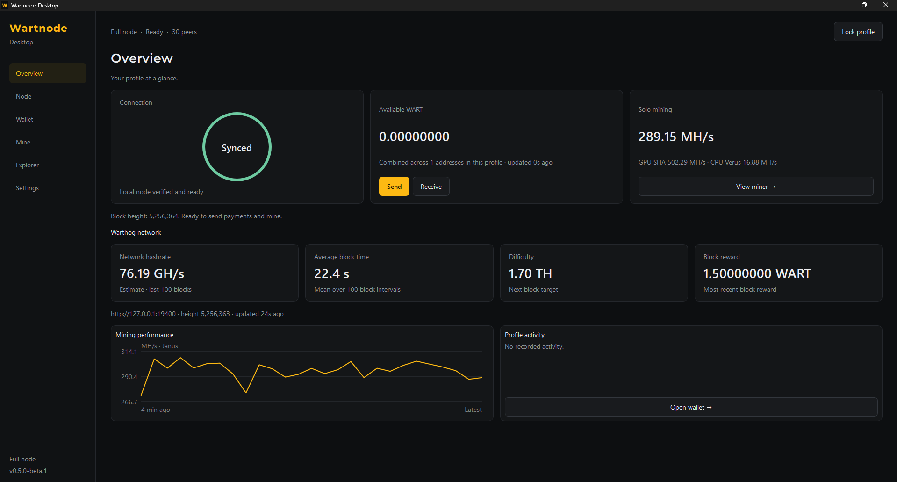
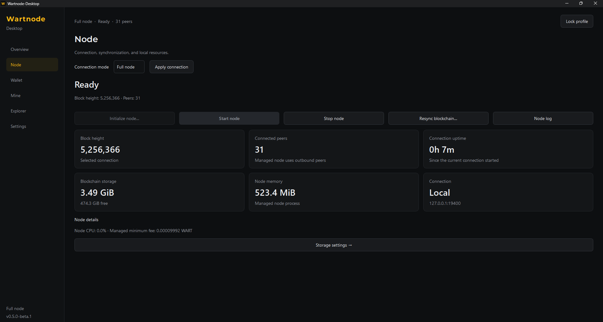
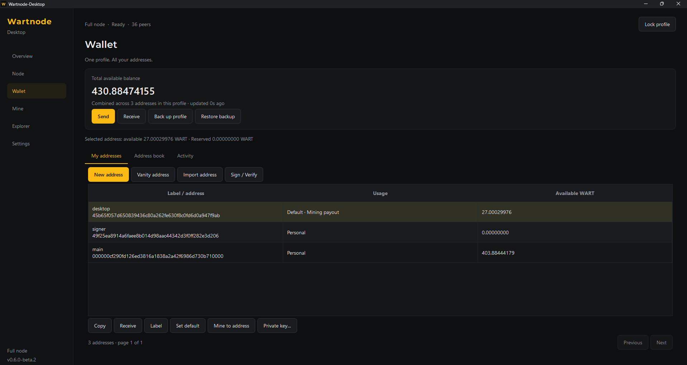
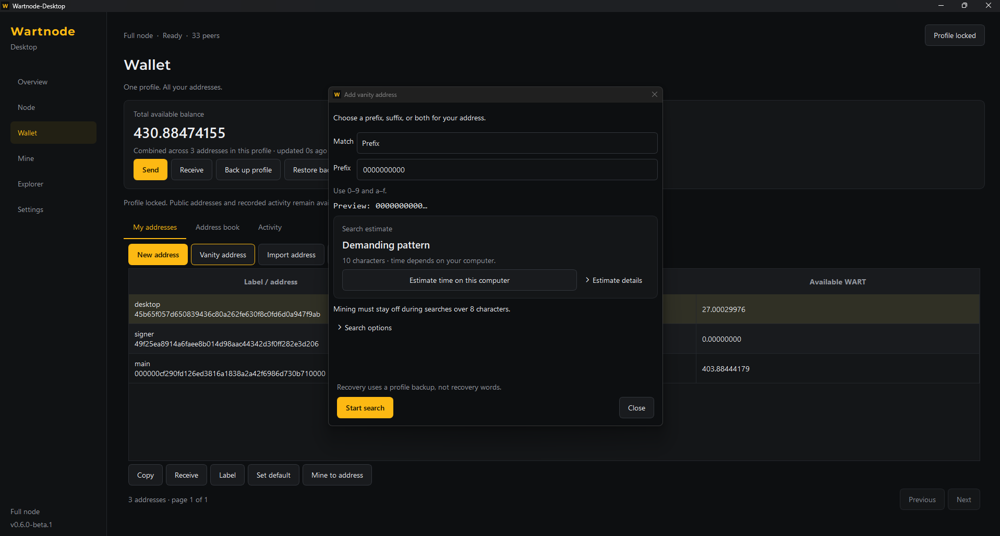
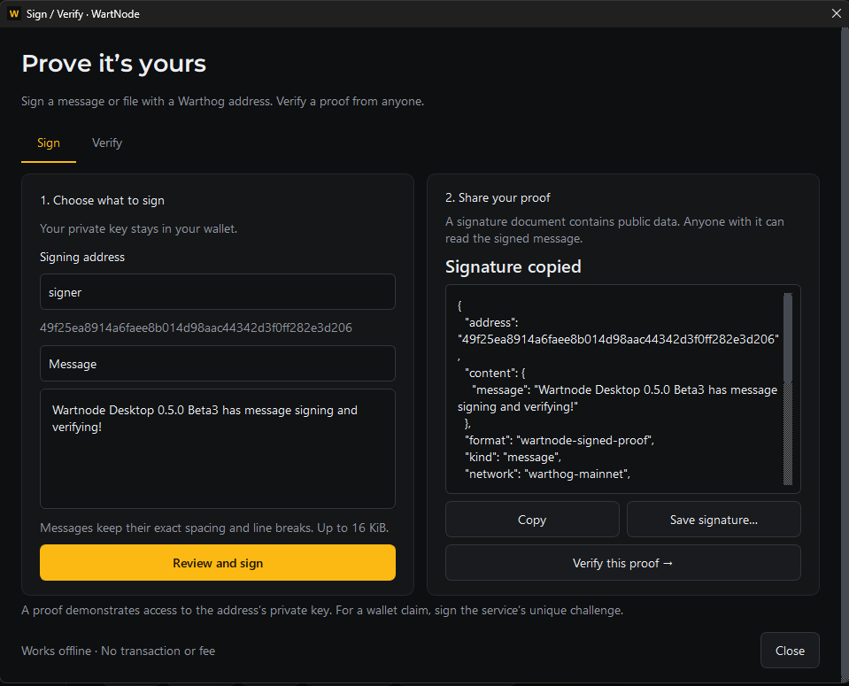
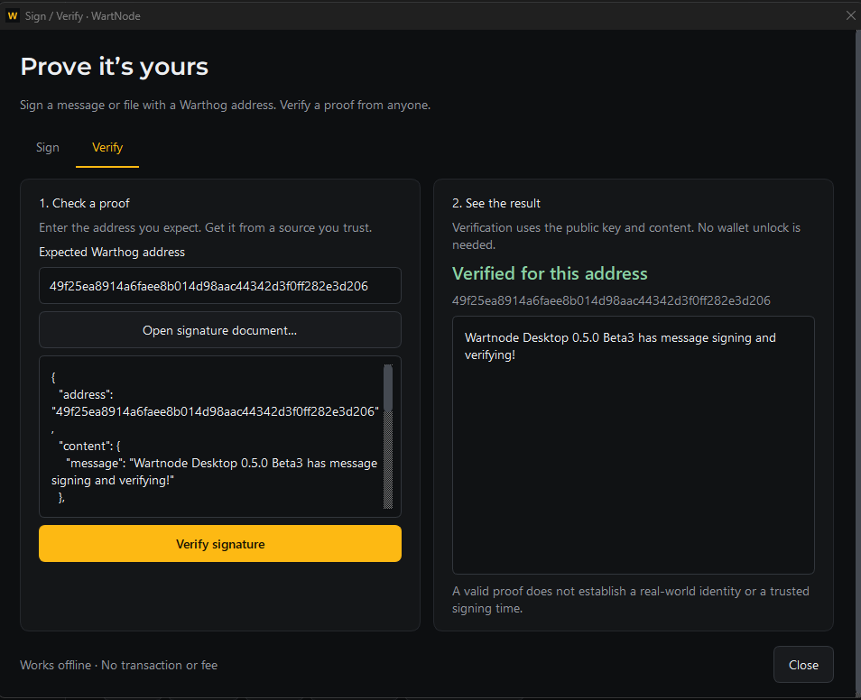
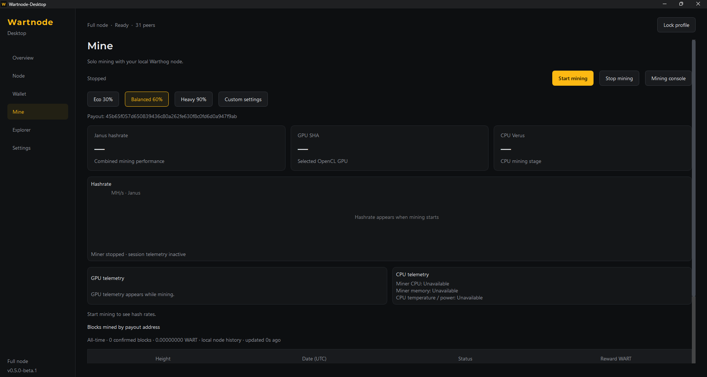
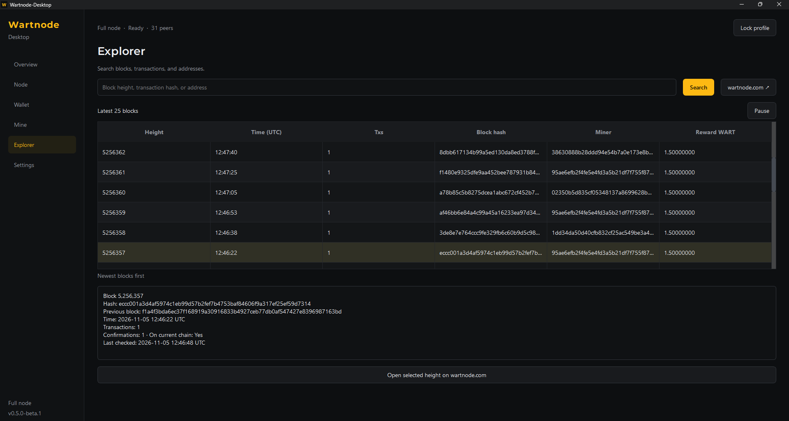
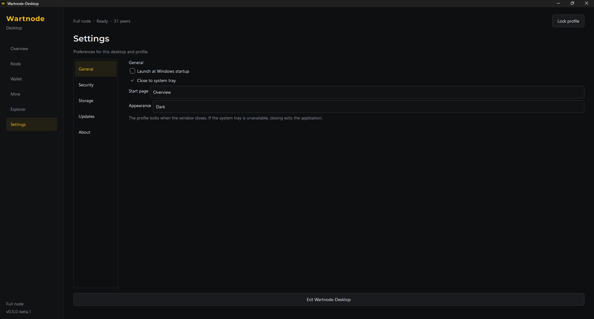

# Wartnode-Desktop screenshots

A tour of the six main pages and Wallet dialogs. Wallet shows
**v0.6.0-beta.2** and the vanity dialog shows **v0.6.0-beta.1**, captured on
November 6, 2026. The November 5 captures show **v0.5.0-beta.3** for Sign / Verify,
**v0.5.0-beta.2** for Mine, and **v0.5.0-beta.1** for the other main pages.
Balances, block heights, network statistics and mining readings reflect the
capture sessions.

[Overview](#overview) · [Node](#node) · [Wallet](#wallet) · [Vanity addresses](#vanity-addresses) · [Sign and Verify](#sign-and-verify) · [Mine](#mine) · [Explorer](#explorer) · [Settings](#settings)

## Overview

See the current connection status, combined available WART across your profile,
and solo mining performance at a glance. Network cards show estimated hashrate,
average block time, difficulty in GH/TH and the latest block reward. A mining
performance chart and profile activity complete the dashboard.

## Node

Choose between Full node and Lite wallet connections, and manage your local
node with initialization, start, stop and resync controls. Block height, peers,
uptime, storage, memory and connection details are shown together, with the
node log available in a separate window.

## Wallet

Manage labeled addresses under one profile password and view their combined
available balance. Create normal or vanity addresses, import existing addresses,
select a default or mining payout address, and access Send, Receive, encrypted
profile backups, the address book and activity history. The selected address's
**Private key…** action reveals or copies its key after password confirmation.

## Vanity addresses

Open **Wallet → My addresses → Vanity address** to search for a prefix, suffix
or both. Preview the pattern, review its difficulty and estimate search time on
your computer. Mining must stay stopped for searches over eight combined
prefix/suffix characters. See the [vanity guide](MVP_GUIDE.md#vanity-addresses)
for saved searches and recovery.

## Sign and Verify

Open **Wallet → My addresses → Sign / Verify** to sign a message or file locally,
or verify a proof against an independently obtained expected address. This works
in Full node and Lite modes; public verification needs no wallet unlock.

### Sign a message

Choose an owned address, enter the message, then review and approve it. Copy the
resulting public signature document or save it as a `.wartproof` file. This
capture shows a signed message with its proof copied for sharing.

### Verify a message

Enter the address you expect and paste or open the signature document. A
successful check displays **Verified for this address** and the signed content.

See the [format and usage guide](SIGNED_PROOFS.md) for file proofs, compatibility
and wallet-claim challenges.

## Mine

Choose Eco 30%, Balanced 60%, Heavy 90% or Custom settings, with configuration
and the mining console in separate windows. While mining, the page presents
Janus, GPU SHA and CPU Verus hashrates, a performance chart, available GPU
sensors, and miner CPU and memory readings. Reward history for the payout
address appears below. This capture shows an active mining session with live
hashrates, session counters, a performance chart and supported telemetry.

## Explorer

Browse the latest 25 blocks and pause updates while inspecting a selected
block. Search by block height, transaction hash or address, and view block
details below the list. Open wartnode.com with the website button, by
double-clicking a height, or with the selected-height action.

## Settings

General preferences control Windows startup, closing to the system tray, the
start page and appearance. Security, Storage, Updates and About group the
remaining profile and application preferences.

[Back to README](../README.md) · [User guide](MVP_GUIDE.md)
